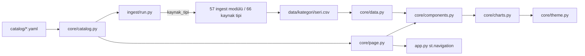

# Repository Guidelines

## Project Overview

BV Market Dashboard — a Streamlit dashboard of Turkish macro/market/commodity
series for BV Portföy internal use. Data is fetched by a scheduled ingest job,
committed into the repo as CSV, and read at runtime by a read-only app.

Two invariants shape everything:

1. **`catalog/series.yaml` is the single source of truth.** Adding a series or
   category is a YAML edit, not a code change. The sidebar, pages, charts, KPI
   cards, and the ingest work list are all generated from the catalog.
2. **The app never touches secrets.** Credentials exist only in GitHub Actions
   (and a local gitignored `.env`) for ingest. The deployed app only reads CSVs.

**All identifiers, docstrings, comments, and UI strings are Turkish.** Follow
that convention (`seri_cek`, `kategorileri_yukle`, `KatalogHatasi`) — do not
introduce English names into existing modules.

## Architecture & Data Flow



**Ingest (write path, CI only).** `ingest/run.py` lists catalog series and
dispatches each by `seri.kaynak_tipi` to a duck-typed adapter (no ABC/Protocol).
The shared contract is `seri_cek(seri, ..., session=...) -> pd.DataFrame` with
columns `date,value` — or `date,<Component>,…` wide for composition series.
`seriyi_yaz` writes `df.to_csv(yol, index=False, float_format="%.5f")`.

**Render (read path, runtime).** `app.py` builds one `st.Page` per category via
`core.page.kategori_sayfasi_yap(kategori)`, then `st.navigation({...}).run()`.
Navigation is `position="top"`; category pages are sectioned by
`Kategori.grup` in `KATEGORI_GRUPLARI` order. Besides categories, `app.py`
registers fixed pages (Genel Bakış — default, Ara, Favoriler, Raporlar, Fonlar,
Veri Takvimi) and one page per entry in `catalog/hisseler.yaml`. Their logic
lives in Streamlit-free modules like `takvim.py`: `core/ozet.py` (per-series
summary rows), `core/rapor.py` (sentences built from measured observations, no
model), `core/favori.py` (`?f=` encoding).
There is **no `pages/` directory** — navigation is fully generated. A single
chart flows: `page._kategoriyi_ciz` → `catalog.seri_listele(slug)` →
`components.grafik_karti` → `data.load_series` → `stats.gorunum_uygula` →
`charts.mevsimsellik_figuru` → `st.plotly_chart`.

**Module layering.** `core/stats.py` and `core/theme.py` are dependency-free
leaves. `core/takvim.py` deliberately does not import Streamlit (pure
computation; rendering lives in `core/page.py`). Keep that separation.

## Key Directories

| Path | Purpose |
|---|---|
| `core/` | App layer: catalog, data I/O, stats, charts, theme, components, page, takvim, ozet, favori, rapor |
| `ingest/` | `run.py` orchestrator + 57 adapter modülü (66 `kaynak_tipi` değerini karşılar) |
| `catalog/` | `series.yaml` (4.226 seri), `categories.yaml` (51 kategori / 6 grup), `hisseler.yaml` (8 hisse) |
| `data/<kategori>/<seri>.csv` | committed CSV artifact (~43 MB), one per series |
| `tests/` | 87 flat pytest files (1.421 test), no `conftest.py`, no fixture data files |
| `docs/superpowers/{specs,plans}/` | Per-phase design specs ve execution planları (Turkish) — **koddan geride kalıyor**, aşağıdaki "Docs Drift" gotchasına bak |

## Project Scale (2026-11-13 itibarıyla)

| | |
| Seri | 4.226 |
| Kategori | 51 (6 `grup` altında) |
| Hisse sayfası | 8 (`catalog/hisseler.yaml`) |
| `kaynak_tipi` değeri | 66 |
| Test | 1.421 passed + 10 network (deselect) |
| `core/` + `ingest/` + `app.py` | ~21.600 satır Python |

`marketvisuals.net` referansının **kendi arama indeksi**
(`assets/search-chart-titles.js`: 118 sayfa, 4.585 başlık) ile başlık bazlı
eşleştirme yapıldı: seri-benzeri 3.812 kalemin **%92,1'i** karşılanıyor (3.512).
Kalanın dağılımı ve kapatılan boşluklar için `docs/kapsam-bosluklari.md`
(yöntem, payda ve kanıt dahil) — orası bu ölçümün tek kaynağıdır.

Ölçümü tekrarlarken: sitede "3.500+ grafik" iddiası **4.584** çıkıyor, ancak
başlık indeksi tablo sütun başlıkları ve UI metinlerini de içeriyor; 3.812'ye
düşülüyor. Yüzdeyi "grafik" değil bu kalem üzerinden ver.

## Development Commands

```bash
pip install -r requirements-dev.txt        # dev/test (superset of ingest + runtime)
streamlit run app.py                       # dev server
pytest                                     # suite; network tests auto-excluded
pytest tests/test_epias.py                 # one file
pytest -m network                          # live-network smoke tests only
EVDS_API_KEY=<key> python -m ingest.run    # refresh all data
python -m ingest.run --only enflasyon/tufe-genel   # debug one series
```

`ingest.run` exit codes: `0` nothing of ours is broken, `1` at least one series
failed because of **our code**, `2` config error (unknown `--only` id, a
`--freq` matching no series, or missing required credentials).
`erisilemez_mi()` classifies connection errors, timeouts, SSL errors, HTTP
403/429/5xx and `epias.BarajRaporlanmamisHatasi` as "source unreachable": those
are printed and listed but exit `0` — a red build must mean a code defect. 404
and 401/402/407 stay red (wrong URL / bad credentials). After
`ARDISIK_HATA_TAVANI` (5) consecutive failures of one `kaynak_tipi`, the rest of
that source is skipped for the run. `--freq daily,weekly` restricts a run to
those frequencies; `python -m ingest.bayat_rapor` prints the stale-series
report and always exits 0.

Locally the dependencies live in `.venv` (the system `python3` has no PyYAML):
prefix commands with `.venv/bin/` (`.venv/bin/pytest`, `.venv/bin/python -m
ingest.run …`). A single test: `.venv/bin/pytest
tests/test_stats.py::test_son_tarih_ve_son_deger`.

**No lint, format, or type-check tooling is configured** — no ruff/black/mypy
config, no pre-commit. Do not add or run one uninvited; match surrounding style.

## Code Conventions & Common Patterns

- **Turkish snake_case identifiers** everywhere, including test names
  (`test_pencere_29_subatta_patlamaz`).
- `from __future__ import annotations` plus modern `X | None` hints in all
  `core/` modules.
- **Frozen dataclasses, not dicts/TypedDict/pydantic**: `Kaynak`, `Kategori`,
  `Seri` (`core/catalog.py`), `TakvimSatiri` (`core/takvim.py`).
- **Caching is split by layer**: `@lru_cache(maxsize=1)` for catalog loaders;
  `@st.cache_data(show_spinner=False)` for `load_series`/`load_wide_series`.
- **Fail loud; never silently misrepresent data.** Custom exceptions
  `KatalogHatasi(Exception)` and `VeriYokHatasi(FileNotFoundError)`. Adapters use
  `kayit[alan]` (raising `KeyError`) rather than `.get()` so an upstream field
  rename crashes ingest instead of writing zeros. `paylara_cevir` yields `NaN`
  on a zero-sum row rather than fake 0% shares.
- **Errors are caught only at render boundaries**, per-item: `components.py`
  turns `VeriYokHatasi` into `st.warning`; `takvim.takvim()` catches per series
  so "a broken CSV drops one row, not the page".
- **Failure isolation in ingest**: one series' exception is collected into
  `hatalar` and never stops the loop; an EPİAŞ login failure drops only
  EPİAŞ-typed series.
- **Run-scoped caches** (`epias_onbellek`, `osd_onbellek`) are created in
  `main()` and threaded through `_cek()` so series sharing an upstream response
  (or PDF bulletin) fetch it once. A single `requests.Session` is shared per run.
- **No `st.session_state`, with one exception.** Widget state is keyed inline,
  e.g. `key=f"gorunum_{kategori.slug}"`, `key=f"kompozisyon_{seri.id}"`. The
  exception is favorites: `core/page.py::_favorileri_yukle`/`_favorileri_kaydet`
  keep `st.session_state["favori_secim"]` mirrored to the `?f=` query parameter.
- Comments carry provenance and defect IDs (`# C1:`, `(M5)`, "Faz 3c final
  incelemesinin Critical bulgusu") tying code to `docs/superpowers/` specs.
  Preserve these; they encode why non-obvious code exists.

### Adding a series

Append to `catalog/series.yaml`, then generate its CSV. `kaynak_tipi` is a
discriminated-union tag; `core/catalog.py::KAYNAK_ALANLARI` defines which extra
fields each type requires and `_dogrula` rejects fields owned by another type.

```yaml
- id: <kategori>/<ad>          # MUST start with "<category>/"
  title: Görünen Ad
  category: <kategori>         # must exist in categories.yaml
  kaynak: { name: TCMB EVDS, url: "https://evds3.tcmb.gov.tr" }
  kaynak_tipi: evds            # 66 değerden biri; tamamı ingest/run.py'de
                              # if/elif zinciriyle eşleşir (KAYNAK_ALANLARI
                              # zorunlu/isteğe bağlı alanları tanımlar)
  unit: "Birim"
  freq: monthly                # daily | weekly | monthly | quarterly | yearly
  evds_code: TP.XXX.YYY
  evds_frequency: "5"          # "1" günlük | "2" haftalık | "5" aylık
  monthly_agg: mean            # mean | last | sum
  charts: [seasonality, level]
```

Then: `python -m ingest.run --only <kategori>/<ad>`.

Type-specific fields: `yahoo_symbol`; `epias_ucu`/`epias_alani`
(+`epias_bilesenler` for composition); `osd_firma` (+`osd_eski_adlar`).
Optional `olcek` scales values (e.g. `0.001` for MWh→GWh).

## Important Files

- `app.py` — entry point; `st.set_page_config` + catalog-driven `st.navigation`.
- `core/catalog.py` — dataclasses, `KAYNAK_ALANLARI`, `_dogrula` validation,
  `seri_listele`/`seri_getir`, and `KOK` (repo root) used by `core/data.py`.
- `core/data.py` — the **only** gateway to `data/`. `seri_csv_oku` returns a
  single-`value` DatetimeIndex frame; `genis_csv_oku` keeps all columns for
  composition series (contracts intentionally not unified).
- `core/page.py::_kategoriyi_ciz` — generic per-category renderer (view selector,
  KPI row, freshness expander, 2-column chart grid).
- `core/theme.py` — dark-mode palette constants only. `RENKLER["kategorik"]` and
  `CIZGI_DESENLERI` keys must match `epias_bilesenler` group names 1:1
  (`tests/test_theme.py` enforces this).
- `.github/workflows/ingest.yml` — **no `cron:` trigger**: `workflow_dispatch`
  only, fired daily at 09:00 TSİ by cron-job.org (GitHub's own schedule lagged
  4–6 hours). Monday/Thursday runs are full; other days pass
  `freq=daily,weekly`, so monthly/quarterly/yearly series (~70% of the catalog)
  refresh twice a week. `permissions: contents: write`; a `concurrency` group
  serialises runs; after `python -m ingest.run` it runs `ingest.bayat_rapor`,
  then `git add data` + conditional commit under `if: always()`, retrying
  `git pull --rebase -X theirs` + push up to five times.
- `.github/workflows/test.yml` — `pytest -v` on push and PR, skipped when only
  `data/**`, `docs/**` or `*.md` changed.
- `.streamlit/config.toml` — dark navy/gold theme, `headless = true`.

## Runtime/Tooling Preferences

- **Python 3.12**, pinned in both workflows. `pyproject.toml` has **no
  `[project]` or `[build-system]` table** — the repo is not an installable
  package; run it directly. Imports resolve via pytest's `pythonpath = ["."]`.
- **Plain `pip`** with layered requirements; no Poetry/uv/pipenv, no lockfile:
  `requirements.txt` (app: streamlit, pandas, plotly, PyYAML, requests) ⊂
  `requirements-ingest.txt` (+pdfplumber, openpyxl, xlrd) ⊂
  `requirements-dev.txt` (+pytest). Keep those three out of `requirements.txt`
  — Streamlit Cloud installs that file and must not gain the PDF/Excel
  dependencies.
- Dependencies use lower bounds only (`streamlit>=1.49`); no upper pins.
- Env vars, ingest-time only: `EVDS_API_KEY`, `EPIAS_USERNAME`,
  `EPIAS_PASSWORD` (GitHub secrets; local gitignored `.env`).
- Deploy: Streamlit Community Cloud, viewer allowlist. The GitHub repo is
  **public** on purpose (owner's decision, confirmed 2026-11-13) — Actions
  minutes are free for that reason. Code and all data are world-readable;
  never commit anything that should not be.

## Testing & QA

- **pytest**, plain `assert`, Turkish test names, no `conftest.py`, no
  `parametrize` (repeated cases are separate functions), `pytest.approx` for
  floats, `pytest.raises(Type, match="…")` to pin type *and* message.
- Fakes are hand-rolled per file — local `SahteOturum`/`SahteYanit` HTTP stubs
  plus `monkeypatch.setattr` on adapter functions. No `responses`/`requests_mock`
  /`pytest-mock`. Fixture data is inline literals; `tmp_path` for file I/O.
- Network tests live only in `tests/test_smoke_network.py`
  (`pytestmark = pytest.mark.network`, per-test `pytest.skip` on missing creds)
  and are excluded by default:

```toml
[tool.pytest.ini_options]
pythonpath = ["."]
testpaths = ["tests"]
addopts = "-m 'not network'"
markers = [
    "network: gerçek kaynağa istek atar; kimlik bilgisi ve internet ister",
```

- **No coverage config** (`--cov`, `.coveragerc`, `[tool.coverage]` all absent).
  Don't claim coverage numbers. Suite is currently 1.421 test (87 dosya,
  ~5 dk); network testleri `-m 'not network'` ile elenir.
- Assertions target observable behavior. Plotly internals
  (`fig.data[0].line.color`) are asserted only because they *are* the contract
  of a chart factory.
- Catalog loaders are `@lru_cache`d: any test overriding
  `catalog.KATALOG_DIZINI` MUST `cache_clear()` before **and** after in
  `try/finally`, or later tests silently read stale data.

## Gotchas

- **CSVs are fully rewritten every run, never appended** — "tam pencereyi
  yeniden çeker (artımlı değil — revizyonlar yakalanmalı)". A careless change to
  an adapter's date-window logic silently truncates history on the next run.
  Exceptions that accumulate instead (existing rows kept, same-date values
  replaced), all in `ingest/run.py`: EPİAŞ `baraj-doluluk` (endpoint returns
  only today's snapshot); `tefas_fon` (incremental from `TEFAS_GERI_GUN` days
  back, merged in `tefas_fon_cek`, written without `float_format`); and every
  type in `BIRIKEN_KAYNAK_TIPLERI` — `tefas`, `thy_ir`, `pgsus_ir`, `iso_pmi`,
  `tmsd` — whose source publishes only the latest periods and never brings the
  old ones back. Add a type there when its upstream is a rolling document.
- **Windows relative to today slide on purpose.** EVDS and Yahoo fetch the last
  15 years, EPİAŞ 5, OSD/ODMD/TÜRKBESD 5, UAB 3, İSTİB 104 weeks, Trabzon TB 400
  days (unless the series sets `start_date`). The oldest rows leaving the CSV
  each run is expected: the source still serves them, so nothing is lost.
  BDDK weekly pages back to `HAFTALIK_ILK_TARIH`; its first few rows jitter
  with the 13-week page alignment.
- **`seriyi_yaz` refuses an empty frame** (raises, existing CSV untouched). On
  2026-10-22 the UAB site was redesigned, the adapter silently returned nothing
  and ten CSVs lost 32 months each. An adapter whose scrape matches nothing
  must raise, not return an empty or shorter frame.
- **`seriyi_yaz` refuses a frame shorter than half the existing CSV** (when
  the CSV has ≥ `KISALMA_ASGARI_SATIR` = 20 rows): raises `VeriKisaldiHatasi`,
  the CSV is kept, and `erisilemez_mi` counts it as a source problem so the run
  stays green. Yahoo returned only the last day for TTF gas on 2, 6 and 11
  November 2026 and a ~2.270-row CSV became one row. For a deliberate
  shortening (catalog cleanup, a new `start_date`, a source swap) run
  `python -m ingest.run --only <id> --kisalmaya-izin-ver`.
- **Catalog fields common to every `kaynak_tipi`** (`ORTAK_ALANLAR`): `olcek`
  and `gecikme_gunu` (added to the freshness threshold in `core/takvim.py`).
  `yayin_notu` marks a series whose upstream is stalled, sparse or blocked; it
  is shown on the card and counted separately in the stale report. Rule: every
  stale series is either fixed, removed, or carries a `yayin_notu`.
- **Turkish upper-casing**: `"Ekim".upper()` is `"EKIM"`, PDFs print `"EKİM"`.
  Build upper-case lookups with `.replace("i", "İ").upper()`.
- **EPİAŞ**: hard 89-day request window (`AZAMI_PENCERE_GUN`; exceeding it →
  HTTP 400 `(BUS)SEF1117`), hence `pencereleri_bol`. The TGT ticket has no
  refresh logic (~2h validity, fine only because a run takes minutes). Incomplete
  hourly days are dropped via the 24-hour completeness filter.
- **EVDS** uses the undocumented `POST https://evds3.tcmb.gov.tr/igmevdsms-dis/fe`
  with a `key` header — not the official evds2 REST API. Values arrive with
  Turkish thousands separators and need stripping.
- **Yahoo requires a Googlebot User-Agent**; a browser UA returns HTTP 429.
- **OSD** bulletin URLs cannot be derived, so the index page is scraped each
  run; `dogrula()` cross-checks per-firm pages 6–9 against the page-2 TOTAL
  column (tolerance 0.5) and requires ≥13 firms, raising on template drift.
- `evds.py`/`yahoo.py` docstrings record reverse-engineered upstream behavior and
  say explicitly not to rediscover it from scratch. Read them before editing.
- **Docs drift: `docs/superpowers/` kodun gerisinde.** Son plan
  `2026-09-08-faz3g-tim-ihracat.md`, ama katalog 66 `kaynak_tipi` taşıyor —
  yani faz 3h+ ve sonrası kod olarak var, spec/plan dosyası yok. Yeni bir
  kaynak adaptörü eklerken faz etiketi uydurma; dosya yoksa belgelerin
  kapsamadığını bil ve kodu doğrulamak için kataloğa/`ingest/run.py`'ye bak.
- **`README.md` güncel** (2026-10-09 sayılar elle eşitlendi): 4.226 seri /
  51 kategori / 8 ticker / 57 adaptör, yol haritası "Faz 3 Planlandı"
  demiyor. Tek eksik: `kaynak_tipi` satırı 8 örnek listeliyor (gerçekte 66
  değer var) — salt örnek, yanlış değil. Sayılar elle tutuluyor, otomatik
  değil: katalog büyüdükçe yeniden ölç (`len(series.yaml)`, `ls ingest`). Doğrulama kaynağı yine de kod +
  `docs/superpowers/specs/`.
- `docs/superpowers/` convention: `specs/YYYY-MM-DD-faz<N><letter>-<slug>-design.md`
  paired with `plans/YYYY-MM-DD-faz<N><letter>-<slug>.md`. Specs carry
  `Durum: Onaylandı` and back-references; the original Next.js/TS spec
  (`2026-08-26-bvmarketdashboard-design.md`) is **superseded** by
  `2026-08-27-streamlit-dashboard-design.md`.
- There is **no `.superpowers/sdd/` content** — don't assume SDD tooling.
